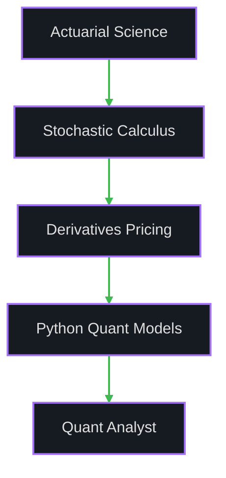

<!-- HEADER -->
<p align="center">
  
</p>

<p align="center"><b>Actuarial Science × Quantitative Finance</b></p>

<p align="center">
  
</p>

<p align="center">
  
  
  <a href="https://www.linkedin.com/in/arturo-vega-5951643a9">
    
  </a>
</p>

---

<!-- PROFILE -->
<h2 align="center">⚡ Quant Profile</h2>

```python
class QuantProfile:
    alias       = "Xeno_QED"
    background  = "Actuarial Science"
    school      = "UAEMéx"
    target      = "Quantitative Analyst"
    languages   = ["Python", "C++"]
    math        = ["Probability",
                   "Statistics",
                   "Stochastic Processes"]
    typesetting = "LaTeX"
    os          = "Fedora Linux"
    brain       = "Obsidian · 3,400+ notes"
    offline     = ["Taekwondo",
                   "Basketball",
                   "Guitar"]
```

---

<!-- FOCUS -->
<h2 align="center">🎯 Quant Focus</h2>

- 📈 **Quantitative finance** — building my path toward becoming a Quant.
- 🛡️ **Actuarial science** — financial modeling and risk analysis.
- 🐍 **Python for financial engineering** — data, models and numerical methods.
- 🧠 **Knowledge systems** — a STEM & Feynman-style Zettelkasten in Obsidian.

<p align="center">
  
  
  
  
  
  
</p>

---

<!-- MATH -->
<h2 align="center">📐 Core Mathematics</h2>

<p align="center"><b>Geometric Brownian Motion</b> — the standard model for asset prices</p>

$$dS_t = \mu S_t \, dt + \sigma S_t \, dW_t$$

<p align="center"><b>Black–Scholes</b> — European call option price</p>

$$C = S_0 \, N(d_1) - K e^{-rT} N(d_2)$$

$$d_1 = \frac{\ln(S_0/K) + (r + \sigma^2/2)T}{\sigma \sqrt{T}}$$

$$d_2 = d_1 - \sigma\sqrt{T}$$

<p align="center"><b>Sharpe Ratio</b> — risk-adjusted performance</p>

$$S = \frac{E[R_p - R_f]}{\sigma_p}$$

---

<!-- MONTE CARLO -->
<h2 align="center">🎲 Monte Carlo in Action</h2>

<p align="center">Simulating asset price paths (purple) to price a European call. Green bars are the outcomes that finish in the money.</p>

<p align="center">
  
</p>

```python
import numpy as np

def mc_call(S0, K, r, vol, T, n=10**5):
    z = np.random.standard_normal(n)
    drift = (r - 0.5 * vol**2) * T
    diff = vol * np.sqrt(T) * z
    ST = S0 * np.exp(drift + diff)
    payoff = np.maximum(ST - K, 0)
    return np.exp(-r * T) * payoff.mean()

print(mc_call(100, 105, 0.05, 0.2, 1))
# ≈ 8.0 (Black–Scholes: 8.02)
```

---

<!-- ROADMAP -->
<h2 align="center">🧭 Path to Quant</h2>



---

<!-- TECH -->
<h2 align="center">🧰 Tech Arsenal</h2>

<h3 align="center">Programming &amp; Data</h3>
<p align="center">
  
</p>

<h3 align="center">Math &amp; Documentation</h3>
<p align="center">
  
</p>

<h3 align="center">Environment &amp; Tools</h3>
<p align="center">
  
</p>

---

<!-- ANALYTICS -->
<h2 align="center">📡 GitHub Analytics</h2>

<p align="center">
  <a href="https://github.com/xenoqed-art">
    
  </a>
  <a href="https://github.com/xenoqed-art">
    
  </a>
</p>

<p align="center">
  
</p>

<p align="center">
  
</p>

---

<!-- CONNECT -->
<h2 align="center">🌐 Let's Connect</h2>

<p align="center">
  <a href="https://www.linkedin.com/in/arturo-vega-5951643a9">
    
  </a>
</p>

<!-- QUOTE -->
<p align="center">
  <em>"What I cannot create, I do not understand."</em><br />
  — Richard Feynman
</p>

<!-- FOOTER -->
<p align="center">
  
</p>
